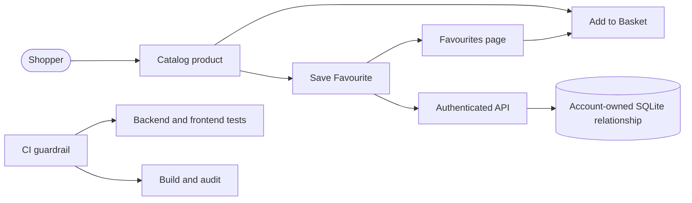

## Summary

Adds private, persistent Favourites for authenticated Shoppers, including optimistic heart toggles with visible rollback errors, a protected Favourites page, account isolation, and resilient authentication transitions. Adds CI quality gates, a tested one-command Windows verifier, multi-level Mermaid architecture documentation, correlated and hardened API responses, automated accessibility checks, database-backed readiness, safe update automation, and a standards-backed enterprise-readiness roadmap.

Cross-PR collaboration: PR #20's explicit stale-request-after-auth-change design highlighted an additional race. This branch now resets card state on identity changes, ignores late success/failure from the previous Shopper, and carries an automated regression test. Thank you @mashjprime for the sharp idea and evidence.

See the [architecture diagrams](https://github.com/lucaintini/workshop-mp-skills-for-ai-native-devs/blob/mash/part-2-new-features/docs/architecture.md), [workshop-quality receipt](https://github.com/lucaintini/workshop-mp-skills-for-ai-native-devs/blob/mash/part-2-new-features/.scratch/workshop-quality/loop.md), [security/resilience receipt](https://github.com/lucaintini/workshop-mp-skills-for-ai-native-devs/blob/mash/part-2-new-features/.scratch/security-resilience/loop.md), [enterprise baseline receipt](https://github.com/lucaintini/workshop-mp-skills-for-ai-native-devs/blob/mash/part-2-new-features/.scratch/enterprise-readiness/loop.md), and [ranked enterprise roadmap](https://github.com/lucaintini/workshop-mp-skills-for-ai-native-devs/blob/mash/part-2-new-features/docs/enterprise-readiness.md).

## Evidence

- **Before:** Shoppers had no way to save catalog items, and the repository had no CI workflow enforcing its existing checks.
  **After:** 59 backend tests and 16 frontend tests pass; PowerShell lifecycle tests, the Vite production build, axe accessibility audit, two Python dependency audits, and `npm audit` pass. Browser verification reaches `/favourites`, validates the document's anti-framing policy, and checks all 12 catalog images. Readiness probes the database; scheduled CI detects drift; Dependabot proposes reviewed npm, uv, and Actions updates. The vulnerable `python-jose` stack was replaced with PyJWT/cryptography. Three additional frontend regression tests came from cross-reviewing PR #20's stale-auth-request design: late failure, same-account late success, and the AuthProvider session-generation contract.

## Merge Danger

**Door:** two-way

The feature and CI workflow can be reverted without destructive data migration. The new table is additive.

**Blast Radius:** shop

Touches catalog cards, authenticated navigation, SQLite schema initialization, and account-scoped API routes. Basket, checkout, and Orders behaviour remain unchanged and covered by the full backend suite.
