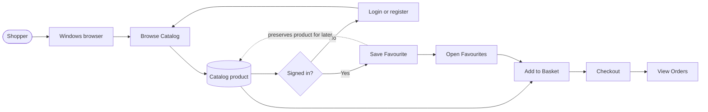
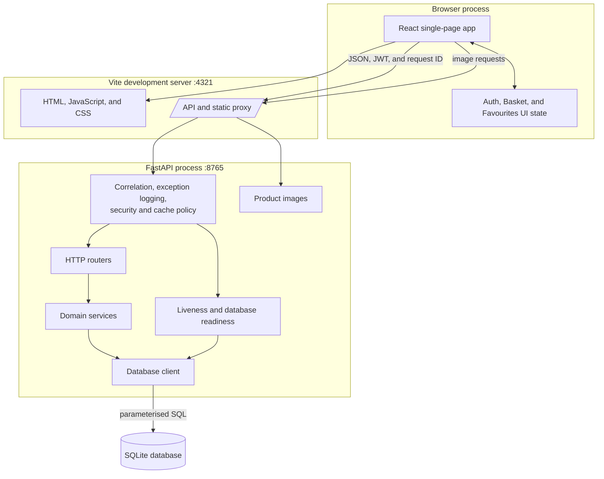
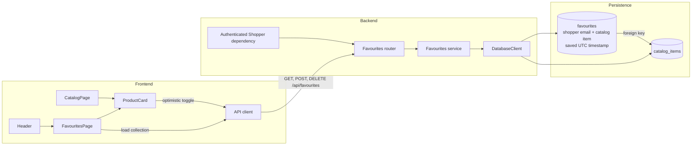
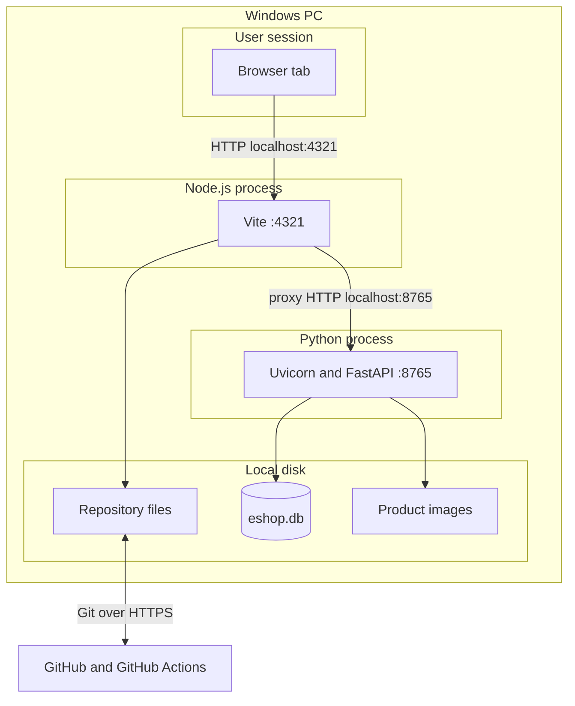
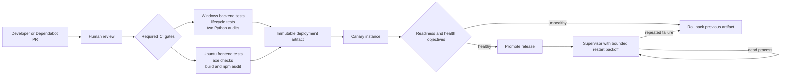
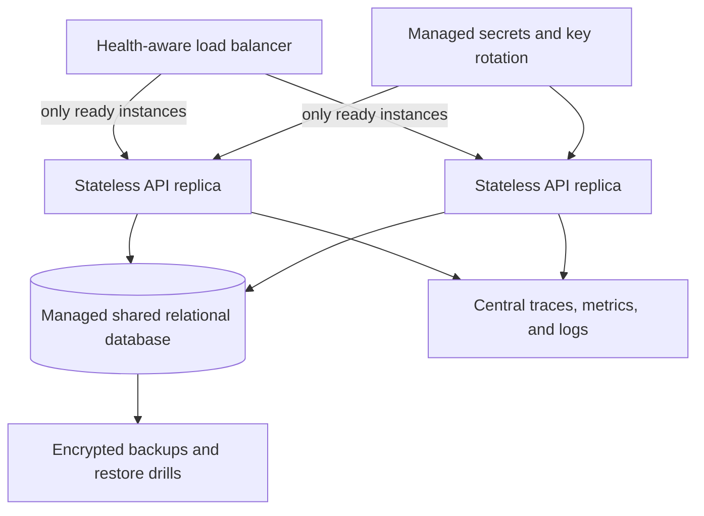
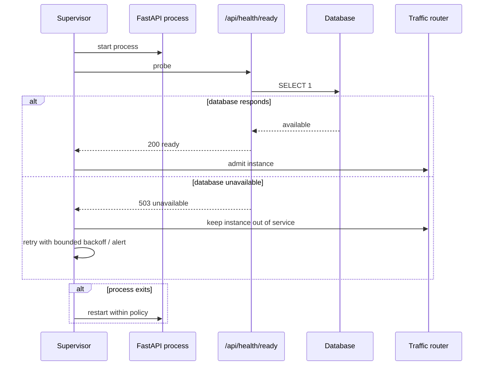

# eShop architecture

These views move from the Shopper's complete journey to the implementation and runtime details. Names match `GLOSSARY.md` and the codebase.

## 1. Shopper-to-product journey



The Favourites path helps a signed-in Shopper return to a product. It never changes Basket, checkout, or Order state.

## 2. High-level software architecture



The browser document and API independently emit anti-framing and browser-hardening headers. Authenticated and sensitive responses use `no-store`; public product images have an explicit cache policy. JWTs are bound to the expected issuer and audience, and production refuses the tutorial signing secret.

## 3. Low-level Favourites architecture



The unique Shopper/product relationship makes saves idempotent. The authenticated Shopper identity scopes every read and write. Failed optimistic changes roll back in the UI and remain visible as errors. Auth state carries a monotonically increasing session generation, and each optimistic request captures both session and operation generations. Login, registration, logout, expiry, or a newer operation synchronously invalidates old continuations, so even logout and same-account login cannot let a stale request mutate the new session.

## 4. Local runtime and hardware topology



All application traffic stays on the local Windows PC. GitHub stores source history and runs clean-room CI; it does not host the local shop.

## 5. Delivery, update, and recovery control flow



Scheduled CI runs weekly to expose runner and dependency drift. Dependabot opens reviewable npm, uv, and GitHub Actions pull requests; it never bypasses tests or silently mutates production. The current repository demonstrates the gates but does not ship a production orchestrator or deployment pipeline.

## 6. Availability and scaling boundary



This is the required production target, not the current local topology. SQLite is intentionally a single-instance workshop boundary. Starting multiple API copies against separate local files would create divergent shopper state, so horizontal scaling must wait for shared managed storage, migrations, backup/restore evidence, and stateless instances.

## 7. Favourite and security data flow

```mermaid
sequenceDiagram
    actor Shopper
    participant Card as ProductCard
    participant API as Frontend API client
    participant Context as Request context middleware
    participant Auth as Auth dependency
    participant Router as Favourites router
    participant Service as Favourites service
    participant DB as SQLite

    Shopper->>Card: select heart
    Card->>Card: update heart optimistically
    Card->>API: save or remove product
    API->>Context: request with JWT and optional request ID
    Context->>Context: validate/generate request ID and apply cache policy
    Context->>Auth: decode signed token; verify issuer, audience, and expiry
    Auth-->>Router: authenticated Shopper email
    Router->>Service: apply Favourite command
    Service->>DB: account-scoped idempotent write
    DB-->>Service: committed result
    Service-->>Router: complete catalog-card data
    Router-->>Context: JSON response
    Context-->>API: response with request ID, security and cache headers
    API-->>Card: confirm state

    alt request fails
        Context->>Context: log exception diagnostics with request ID
        API-->>Card: error
        Card->>Card: roll back heart and show error
    end
```

Every boundary is exercised through the FastAPI HTTP seam in backend tests and through component/router behaviour in frontend tests.

## 8. Health and restart sequence



`/api/health` is a liveness signal; `/api/health/ready` additionally probes the database. Restarting a live but dependency-unready process forever is not recovery: production policy should remove it from traffic, retain diagnostics, use bounded retries, and roll back or escalate when the objective gate remains unhealthy.
